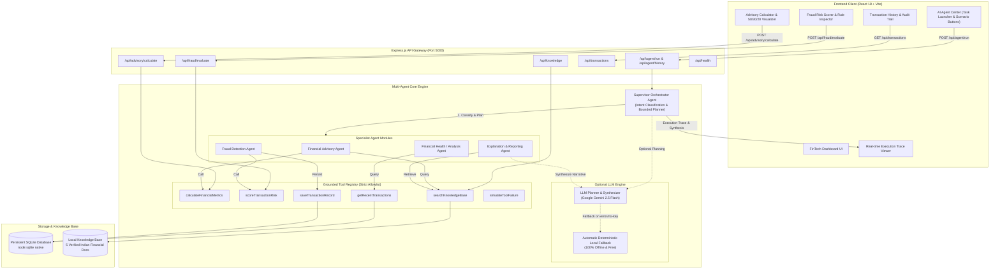
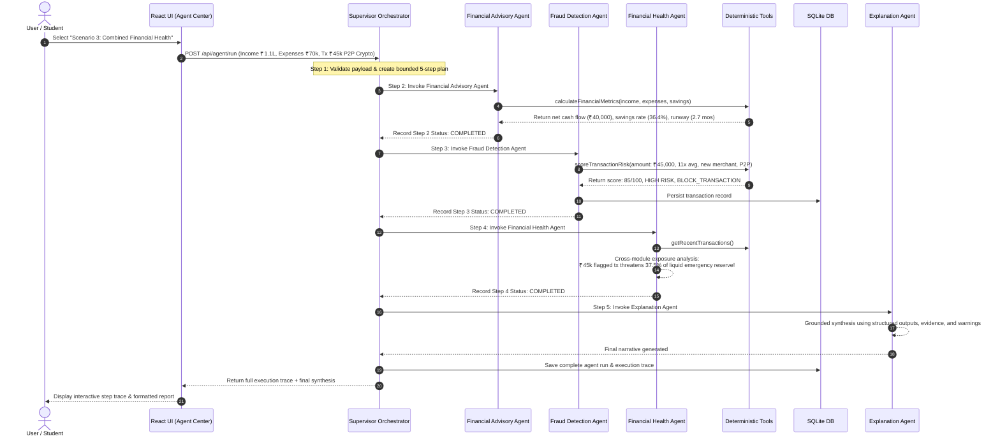

# System Architecture — Project 418

## 1. Overview
**Project 418** is an **Agentic AI-Based Smart Financial Advisory and Fraud Detection System** designed specifically for the Indian financial context (INR ₹, 50/30/20 budgeting rule adapted for Indian metro living costs, and UPI transaction patterns).

Unlike monolithic financial dashboards with static scripts or isolated AI chatbots, Project 418 implements an **autonomous multi-agent architecture** governed by a Supervisor Orchestrator. The system coordinates deterministic financial planning, transparent heuristic fraud detection, cross-module exposure analysis, and grounded non-expert explanation.

---

## 2. Mermaid Architecture Diagram

---

## 3. Agent Execution Sequence Diagram

The sequence diagram below illustrates how **Scenario 3 (Combined Financial Health)** executes across multiple specialist agents:

---

## 4. Key Architectural Decisions

### 4.1 Bounded Supervisor vs. Autonomous Loops
Unbounded agent loops can lead to infinite execution cycles, runaway API costs, or nondeterministic halts. In Project 418:
- The **Orchestrator** enforces a **maximum limit of 6 steps** per workflow.
- It enforces a **15,000 ms execution timeout**.
- It enforces a **strict tool allowlist** (`ALLOWED_TOOLS`). Any tool invocation outside the registry is rejected.

### 4.2 Grounded Deterministic Calculations vs. Generative Hallucinations
LLMs are notoriously prone to arithmetic hallucinations. In personal finance and fraud risk scoring, hallucinations are unacceptable:
- **Net Cash Flow, Savings Rate, 50/30/20 Deviations, and Emergency Buffer Runway** are calculated mathematically in `server/src/tools/advisoryCalculator.js`.
- **Fraud Risk Scores (0-100)** and triggered heuristic rules are scored deterministically in `server/src/tools/fraudScorer.js`.
- The optional LLM is strictly restricted to **synthesizing natural language explanations** from verified structured outputs.

### 4.3 Native Zero-Dependency SQLite (`node:sqlite`)
Instead of requiring native C++ build tools (like `node-gyp` or Visual Studio Build Tools which frequently fail on Windows during `better-sqlite3` installs), Project 418 uses Node.js 22's built-in `node:sqlite` (`DatabaseSync`). This guarantees 100% install reliability on Windows without external prerequisites.
